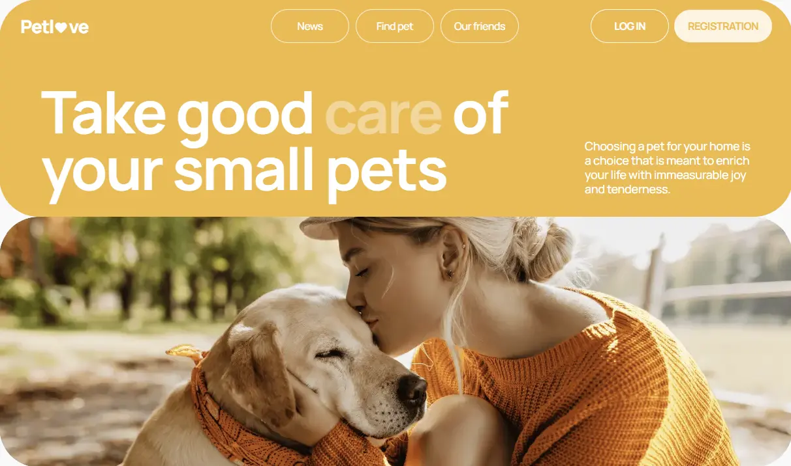

# 🐾 PetLove

**PetLove** is a responsive web application designed to help people find pets, explore adoption listings, and discover useful information about animal care.

Users can browse available pets, filter and sort listings, save their favorite animals, view detailed information, and manage their profiles.

🔗 **Live Demo:** [PetLove](https://pet-love-steel.vercel.app/)  
💻 **Repository:** [GitHub](https://github.com/Anastasiia-Kosh/PetLove)

---

## ✨ Features

- **User Authentication** — registration, login, logout, and session restoration.
- **Pet Listings** — browse available animals with detailed information and photos.
- **Search & Filtering** — find pets by keyword, category, species, sex, and location.
- **Sorting** — sort listings by popularity and price.
- **Pagination** — navigate through multiple pages of pet listings.
- **Favorites** — add pets to favorites and manage saved listings.
- **Pet Details** — view additional information about an animal.
- **User Profile** — manage personal information and uploaded pets.
- **Pet Management** — add pets to your profile and remove them.
- **News** — browse and search articles related to pets.
- **Our Friends** — explore partner organizations and useful resources.
- **Responsive Design** — layouts adapted for mobile, tablet, and desktop screens.
- **Loading States & Error Handling** — provide feedback during asynchronous operations and when requests fail.

## 🛠️ Tech Stack

### Frontend

- Next.js (App Router)
- React
- TypeScript
- CSS Modules
- Redux Toolkit
- React Redux

### Forms & Validation

- React Hook Form
- Yup
- `@hookform/resolvers`

### API & Utilities

- Axios
- React Hot Toast
- React Select
- React Paginate

### Deployment

- Vercel

### Backend

- External REST API provided for the project

## 🏗️ Architecture

The application uses the Next.js App Router and separates pages, reusable UI components, API requests, and global state management.

- **App Router** — page routing and URL-based search parameters.
- **Reusable Components** — shared components for listings, filters, pagination, forms, and modals.
- **API Layer** — centralized HTTP requests using Axios.
- **Redux Toolkit** — global authentication and user-related state.
- **CSS Modules** — component-scoped styling.
- **Next.js Image** — optimized image rendering.

## 🚀 Getting Started

### Prerequisites

- Node.js
- npm

### Installation

1. Clone the repository:

   ```bash
   git clone https://github.com/Anastasiia-Kosh/PetLove.git
   ```

2. Navigate to the project directory:

   ```bash
   cd PetLove
   ```

3. Install dependencies:

   ```bash
   npm install
   ```

4. Create a `.env.local` file in the project root and configure the API URL:

```env
NEXT_PUBLIC_API_URL=
NEXT_PUBLIC_SITE_URL=
NEXT_PUBLIC_CLOUDINARY_CLOUD_NAME=
NEXT_PUBLIC_CLOUDINARY_UPLOAD_PRESET=
NEXT_PUBLIC_CLOUDINARY_AVATAR_UPLOAD_PRESET=
```

See `.env.example` for the required variables.

5. Start the development server:

   ```bash
   npm run dev
   ```

6. Open [http://localhost:3000](http://localhost:3000) in your browser.

## 📜 Available Scripts

| Command         | Description                  |
| --------------- | ---------------------------- |
| `npm run dev`   | Start the development server |
| `npm run build` | Create a production build    |
| `npm run start` | Start the production server  |
| `npm run lint`  | Run ESLint                   |

## 👩‍💻 Author

**Anastasiia Kosh**

[GitHub](https://github.com/Anastasiia-Kosh)

---

## Maket

[Figma](https://www.figma.com/file/puMNfZVg4YI8UZoJ1QiLLi/Petl%F0%9F%92%9Bve?type=design&node-id=55838-750&mode=design&t=Xg1IwIcKebTl5xGs-0)
